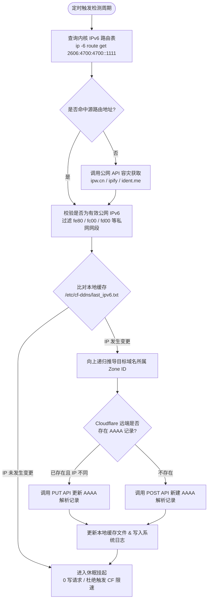

# <div align="center">⚡ Cloudflare IPv6 DDNS</div>

<div align="center">

**专为 Linux 环境打造的极简、高性能 Cloudflare IPv6 动态域名解析 (DDNS) 自动化方案**

[](LICENSE)
[](https://www.kernel.org)
[](https://www.python.org)
[](https://www.docker.com)
[](https://en.wikipedia.org/wiki/IPv6)

<p align="center">
  <a href="#-一键极速安装">⚡ 极速安装</a> •
  <a href="#-为什么选择本项目">📊 核心优势</a> •
  <a href="#-工作原理">🛠️ 工作原理</a> •
  <a href="#-日常运维与快捷管理">🎮 日常运维</a> •
  <a href="#-配置文件手动管理">⚙️ 配置指南</a> •
  <a href="#-常见问题-faq">❓ 常见问题</a>
</p>

</div>

---

## ⚡ 一键极速安装

在目标 Linux 终端直接执行以下命令，即可全自动拉取脚本并启动可视化交互配置向导：

```bash
curl -fsSL https://raw.githubusercontent.com/by1021/cloudflare-ipv6-ddns/main/install.sh | bash
```

<details>
<summary><b>备用安装命令（点击展开：wget / 国内服务器加速源 / 手动克隆）</b></summary>

- **使用 wget 安装**：
  ```bash
  wget -qO- https://raw.githubusercontent.com/by1021/cloudflare-ipv6-ddns/main/install.sh | bash
  ```

- **国内服务器加速通道（免翻墙）**：
  ```bash
  curl -fsSL https://ghfast.top/https://raw.githubusercontent.com/by1021/cloudflare-ipv6-ddns/main/install.sh | bash
  ```

- **手动克隆源码仓库安装**：
  ```bash
  git clone https://github.com/by1021/cloudflare-ipv6-ddns.git
  cd cloudflare-ipv6-ddns
  chmod +x cf-ipv6-ddns.sh
  sudo ./cf-ipv6-ddns.sh
  ```
</details>

> 💡 **设计说明**：安装脚本已包含提权检测与安全终端劫持，无论以普通用户或 root 执行均可正常弹出交互提示。安装完成后，系统将自动注入全局命令 `cf-ipv6-ddns`。

### 交互向导预览

```text
==================================================
           Cloudflare IPv6 DDNS 安装向导          
==================================================
[+] 自动检测到本机 IPv6: 240e:xxx:xxx:xxxx::1

1. 请输入 Cloudflare API Token 或 Global Key: ****************************************
2. 请输入完整解析域名 (如 ddns.example.com): debian.example.com
3. 请输入检测循环周期 (秒) [默认 60]: 60

请选择部署模式:
  [1] 宿主机原生部署 (Systemd 守护, 纯标准库, 内存约 6MB) [默认推荐]
  [2] Docker 容器部署 (基于轻量 Go 镜像, 独立容器隔离)
请输入选项 [1 或 2, 默认 1]: 1

[✔] 部署完成！
  - 查看服务状态: systemctl status cf-ddns
  - 实时查看日志: journalctl -u cf-ddns -f
  - 快捷管理命令: cf-ipv6-ddns
```

---

## 📊 为什么选择本项目？

市面上存在较多 DDNS 方案（如 `ddclient`、定时 cron 脚本或庞大的容器镜像），但在 IPv6 动态解析场景常遇到**内存开销高、必须硬编码绑定物理网卡（如 eth0/ens18）、多网卡环境获取到 ULA 内网地址、或无缓存机制高频请求触发 Cloudflare 速率限制**等痛点。

| 特性维度 | 本项目 (`cloudflare-ipv6-ddns`) | 传统 Shell DDNS 脚本 | ddclient / 常用容器镜像 |
| :--- | :--- | :--- | :--- |
| **网卡配置** | 🏆 **零配置**（基于内核智能路由寻路） | ❌ 必须写死网卡名（如 `eth0`） | ⚠️ 需配置网络模式或环境变量 |
| **虚拟化与迁移** | 🏆 物理机/PVE/ESXi 虚拟机迁移**零改动** | ❌ 换宿主机或网卡重命名后直接失效 | ⚠️ 容器网络桥接易拿到 Docker 私网 IP |
| **内存开销** | 🏆 **约 6MB**（常驻休眠 CPU 0.0%） | ⚠️ 依赖定期 cron 重复拉起进程开销大 | ❌ 30MB ~ 100MB+ |
| **CF 鉴权体系** | 🏆 **双模式兼容**（Token & Global Key 自动识别） | ⚠️ 绝大多数仅支持单一凭据 | ⚠️ 部分仅支持 Global Key |
| **Zone 推导** | 🏆 **自动向上递归推导** Zone ID | ❌ 需用户手动登录控制台查找复制 | ⚠️ 需填写 Zone ID |
| **防刷保护** | 🏆 **本地差分缓存**（IP 未变动 0 写请求） | ❌ 每次无脑发起 PUT/POST 写请求 | ⚠️ 规则配置复杂 |
| **依赖要求** | 🏆 纯 Python3 标准库（**零 pip 第三方依赖**） | ⚠️ 强依赖外部 curl/jq/grep 版本 | ⚠️ 强依赖 Docker 守护进程 |
| **综合运维工具** | 🏆 内置 `cf-ipv6-ddns` 交互管理 CLI | ❌ 无管理工具，改配置需手动修脚本 | ⚠️ 需要使用 docker 命令维护 |

---

## 🛠️ 工作原理

程序采用 **内核选路 + 差分缓存 + 异步容灾** 设计，确保微秒级变动捕获与极低资源消耗：



---

## 🔑 Cloudflare 凭证准备（二选一）

本方案原生兼容 Cloudflare 的两种身份凭据体系：

### 推荐方式：创建 40 位精细化 API 令牌 (API Token)
1. 登录 [Cloudflare 控制台](https://dash.cloudflare.com/)。
2. 点击右上角头像 $
ightarrow$ **我的个人资料 (My Profile)** $
ightarrow$ **API 令牌 (API Tokens)**。
3. 点击 **创建令牌 (Create Token)**，选择 **编辑区域 DNS (Edit zone DNS)** 模板，点击 **使用模板**。
4. 确认权限包含：
   - `区域 (Zone)` - `DNS` - `编辑 (Edit)`
   - `区域 (Zone)` - `区域 (Zone)` - `读取 (Read)`
5. 区域资源选择 `包括 (Include)` $
ightarrow$ `所有区域 (All zones)`（或指定您的特定域名）。
6. 点击创建并复制生成的 **40 位字符令牌**（格式如 `V-8qK9_...`）。
> 📌 **说明**：使用 API Token 时**无需提供 Cloudflare 登录邮箱**。

---

### 兼容方式：使用 37 位全局密钥 (Global API Key)
若您使用的是账户默认的 Global API Key（37 位十六进制字符串，如 `f9a54530...`）：
- 按照 Cloudflare 官方规范，**Global API Key 必须配合注册账号邮箱**才能调用 API。
- 运行安装向导输入该密钥时，脚本会自动识别 37 位格式并主动提示您输入**绑定的 Cloudflare 邮箱**。

---

## 🎮 日常运维与快捷管理

安装完成后，程序已注册为系统全局快捷命令 `cf-ipv6-ddns`，无需记忆复杂的脚本路径：

### 综合管理菜单
```bash
sudo cf-ipv6-ddns
```
执行后即可进入可视化管理控制台：
```text
==================================================
        Cloudflare IPv6 DDNS 综合管理程序        
==================================================
 1. 一键安装 / 重新配置 (Install / Reconfigure)
 2. 查看服务状态与最近日志 (Status & Logs)
 3. 重启运行服务 (Restart)
 4. 停止当前运行服务 (Stop)
 5. 彻底卸载服务与配置 (Uninstall)
 0. 退出
--------------------------------------------------
请选择操作 [0-5]:
```

### 快捷子命令（适合自动化运维）
```bash
sudo cf-ipv6-ddns status      # 查看当前服务状态与最近 15 行日志
sudo cf-ipv6-ddns restart     # 重启 DDNS 守护进程
sudo cf-ipv6-ddns stop        # 停止 DDNS 守护进程
sudo cf-ipv6-ddns uninstall   # 彻底卸载服务与配置文件
```

### 原生排错与解析验证
```bash
# 查看 Systemd 服务实时运行状态
sudo systemctl status cf-ddns

# 实时追踪动态解析日志
sudo journalctl -u cf-ddns -f

# 通过公共 DNS 验证 AAAA 记录是否已生效
dig @223.5.5.5 AAAA 你的域名.com +short
```

---

## ⚙️ 配置文件手动管理

安装完成后，配置文件存储于 `/etc/cf-ddns/config.json`（权限严格受限为 `600`）：

### 1. 使用 API Token 的配置示例
```json
{
  "token": "你的40位APIToken",
  "email": "",
  "domain": "ddns.example.com",
  "interval": 60
}
```

### 2. 使用 Global API Key 的配置示例
```json
{
  "token": "你的37位GlobalAPIKey",
  "email": "your_email@example.com",
  "domain": "ddns.example.com",
  "interval": 60
}
```

修改配置文件后，重启服务即可生效：
```bash
sudo cf-ipv6-ddns restart
```

---

## ❓ 常见问题 (FAQ)

<details>
<summary><b>Q1: 如何在安装前确认本机已拥有公网 IPv6 地址？</b></summary>

在终端执行：
```bash
ip -6 route get 2606:4700:4700::1111
```
若回显包含 `src 240e:...`、`src 2408:...` 或 `src 2409:...` 等以 `2xxx:` 开头的全局单播地址，说明网络已正确分配公网 IPv6。若显示 `Network is unreachable`，请先检查本地光猫或路由器 IPv6（SLAAC/DHCPv6）开关。
</details>

<details>
<summary><b>Q2: 为什么无需指定物理网卡名称（如 eth0、ens18）？</b></summary>

传统方案大多通过 `ip addr show eth0` 匹配地址，在虚拟机热迁移、PVE 桥接或存在虚拟网卡（Docker / Tailscale / WireGuard）时网卡名常发生变动。本项目直接向 Linux 内核路由栈查询通往外网目标的最优源地址（Source IP），由内核微秒级自动选路，无缝适配任何多网卡复杂环境。
</details>

<details>
<summary><b>Q3: API 报错 10000 或提示找不到有效 Zone？</b></summary>

- **10000 错误**：Token 无效或已过期，请在 Cloudflare 重新生成并核验。
- **找不到有效 Zone**：请确认您的根域名（如 `example.com`）确实在当前 Cloudflare 账户下，且 Token 的权限范围包含了该域名所在的 Zone。
</details>

---

## 📄 License

本项目基于 [MIT License](LICENSE) 开源。欢迎 Star 支持或提交 PR 贡献代码！
